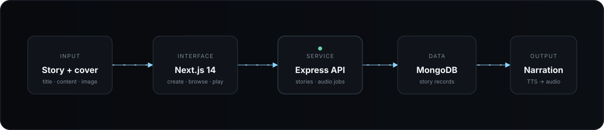
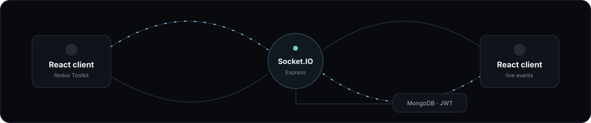

PRINCE KUMAR&nbsp;&nbsp;—&nbsp;&nbsp;SOFTWARE ENGINEER&nbsp;&nbsp;—&nbsp;&nbsp;NEW DELHI

<h1 align="center">Interfaces with restraint. Systems with a pulse.</h1>

  I build full-stack web products where the interaction and the infrastructure 
  have to work as one—from real-time messaging to AI-generated narration.

  <a href="https://prince-portfolio-hmwm.vercel.app/">Portfolio</a>
  &nbsp;&nbsp;/&nbsp;&nbsp;
  <a href="https://www.linkedin.com/in/prince2024/">LinkedIn</a>
  &nbsp;&nbsp;/&nbsp;&nbsp;
  <a href="mailto:princekumarbug12344@gmail.com">Email</a>
  &nbsp;&nbsp;/&nbsp;&nbsp;
  <a href="https://x.com/Prince_NITrr24">X</a>

  

 

I’m a software engineer and NIT Raipur ’24 graduate. My public work is concentrated around **React and Next.js interfaces**, **Node.js and Express services**, **MongoDB-backed applications**, and the boundaries where products become interesting: authentication, live events, payments, and generated media.

The common thread is integration. I like projects where a polished screen is only the visible edge of a larger system.

---

## Two systems, up close

### StoryToVoice

**A reading experience that turns submitted stories into playable narration.** The Next.js client handles story creation, browsing, sharing, and audio playback. An Express service persists stories in MongoDB and connects the content pipeline to ElevenLabs and Google text-to-speech tooling.

  

`Next.js 14` &nbsp; `TypeScript` &nbsp; `Express` &nbsp; `MongoDB` &nbsp; `ElevenLabs` &nbsp; `Google TTS`

[Repository](https://github.com/PrinceNitrr24/StoryToVoice) · [Live demo](https://story-to-voice-pi.vercel.app)

 

### princeDevChat

**A real-time messaging application built around authenticated, event-driven communication.** The React client uses Redux Toolkit for application state while Socket.IO carries live messages through the Express service. MongoDB stores application data; JWT and email tooling support account flows.

  

`React` &nbsp; `Redux Toolkit` &nbsp; `Socket.IO` &nbsp; `Express` &nbsp; `MongoDB` &nbsp; `JWT`

[Repository](https://github.com/PrinceNitrr24/princeDevChat) · [Live demo](https://prince-dev-chat.vercel.app)

---

## More of the work

| | Project | What it demonstrates |
|:--|:--|:--|
| **Product** | [MERN Job Portal](https://github.com/PrinceNitrr24/Mern-job-portal) · [demo](https://mern-job-portal-two.vercel.app) | Job discovery and form workflows with React, Auth0, Firebase, Express, and MongoDB. |
| **Commerce** | [SaaS Subscription Flow](https://github.com/PrinceNitrr24/SAAS) | A React client connected to an Express service, Firebase Admin, and Stripe billing. |
| **Backend** | [File App](https://github.com/PrinceNitrr24/File_App) | A small Express/EJS application that creates, reads, renames, and deletes filesystem-backed notes. |
| **API study** | [Django Quiz API](https://github.com/PrinceNitrr24/Django-app) | Django REST Framework models and endpoints for categories, quizzes, questions, answers, and random-question retrieval. |
| **Tooling study** | [Vulnerability Scanner](https://github.com/PrinceNitrr24/Vulnerability-Scanner-) | A focused Python/Nmap experiment that reports open ports, state, protocol, and detected services. |

The smaller studies stay visible because they show the path from browser-only interfaces toward APIs, systems, and tooling.

---

## Working set

<table>
  <tr>
    <td width="25%">LANGUAGES  <b>TypeScript</b> <b>JavaScript</b> Python HTML · CSS</td>
    <td width="25%">INTERFACES  <b>React</b> <b>Next.js</b> Redux Toolkit Tailwind CSS</td>
    <td width="25%">SYSTEMS  <b>Node.js</b> <b>Express</b> Socket.IO Django REST</td>
    <td width="25%">DATA + SERVICES  <b>MongoDB</b> Firebase Stripe Text-to-speech APIs</td>
  </tr>
</table>

These are technologies visible in the repositories above—not an inventory of every tool I have encountered.

---

## Engineering note

The strongest direction in my public work is the space between a user action and the system reaction: a message arriving without refresh, a story becoming audio, an authenticated workflow reaching the right data, or a payment event crossing a service boundary. That is where interface decisions become architecture decisions—and where I’m doing my most useful work.

 

  

