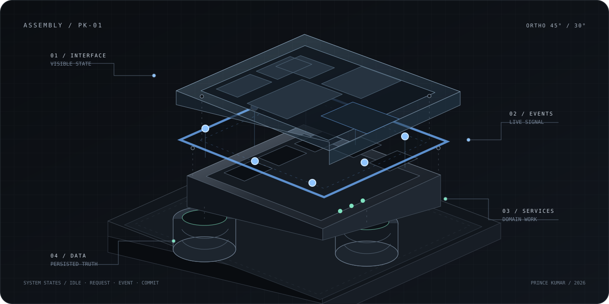
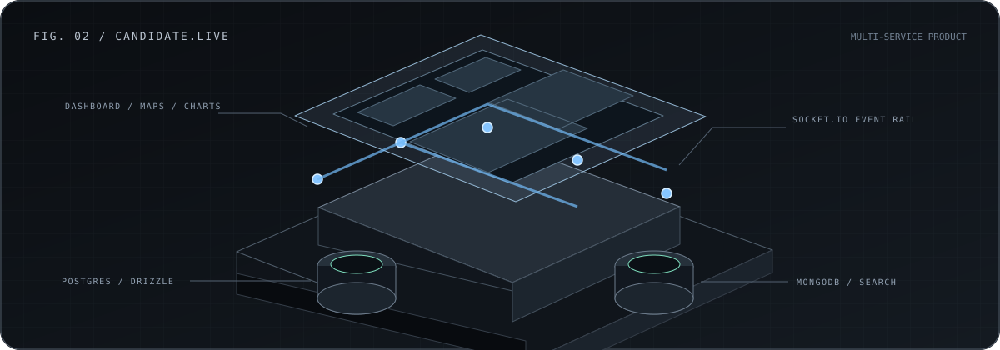
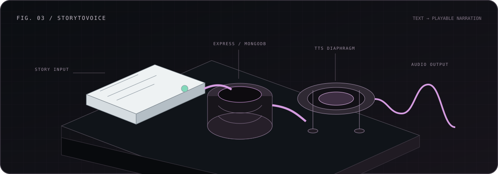
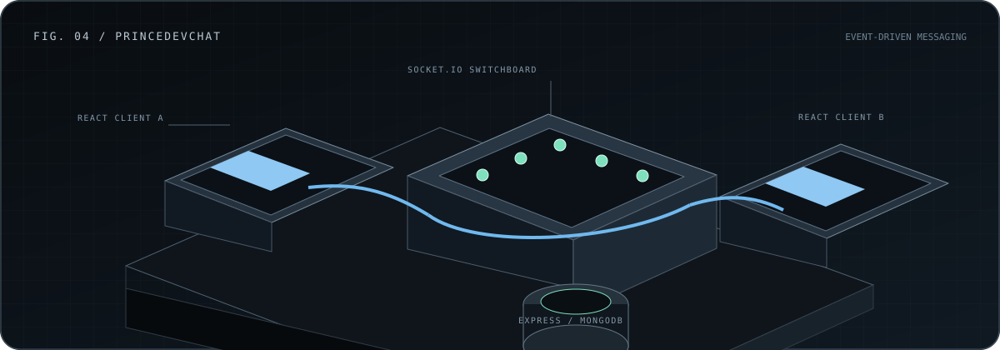

PRINCE KUMAR · SOFTWARE ENGINEER · NEW DELHI

<h1 align="center">I build systems that respond.</h1>

  Full-stack products where interfaces, service boundaries, real-time events, 
  and data paths are designed as one working machine.

  <a href="https://prince-portfolio-hmwm.vercel.app/">Portfolio</a>
  &nbsp;·&nbsp;
  <a href="https://github.com/PrinceNitrr24?tab=repositories">Repositories</a>
  &nbsp;·&nbsp;
  <a href="https://www.linkedin.com/in/prince2024/">LinkedIn</a>
  &nbsp;·&nbsp;
  <a href="mailto:princekumarbug12344@gmail.com">Email</a>

  

FIG. 01 — PRODUCT SYSTEM, EXPLODED · INTERFACE / EVENTS / SERVICES / DATA

---

## The work

I’m a software engineer and NIT Raipur ’24 graduate. My public work is strongest where a product crosses several boundaries: a React or Next.js interface, a Node.js service, an event channel, and persistent data.

I care about what happens after the button is pressed—whether the request is understandable, the state change is deliberate, and the result reaches the user without friction.

 

## Working set

<table>
  <tr>
    <td width="25%" valign="top">LANGUAGES  <b>TypeScript</b> <b>JavaScript</b> Python HTML · CSS</td>
    <td width="25%" valign="top">INTERFACES  <b>React</b> <b>Next.js</b> Redux Toolkit Tailwind CSS · MUI</td>
    <td width="25%" valign="top">SERVICES  <b>Node.js</b> <b>Express</b> Socket.IO Django REST</td>
    <td width="25%" valign="top">DATA + DELIVERY  <b>MongoDB</b> PostgreSQL · Drizzle Firebase Vercel · Render · AWS</td>
  </tr>
</table>

Every technology above appears in public source or project documentation.

---

## Selected systems

### 01 / Candidate.live

  

**A multi-service candidate platform with a Next.js dashboard and Express backend.** The repository combines uploads, maps, charts, Socket.IO events, MongoDB, PostgreSQL through Drizzle, and ingestion/search services. Its own hardening notes identify authentication replacement and complete organization scoping as ongoing work.

`Next.js 14` · `React` · `Express` · `Socket.IO` · `Drizzle` · `PostgreSQL` · `MongoDB`

[Inspect repository →](https://github.com/PrinceNitrr24/candidate_live_next)

 

### 02 / StoryToVoice

  

**A reading experience that turns submitted stories into playable narration.** The Next.js client handles story creation, browsing, sharing, and playback; an Express service persists stories in MongoDB and connects the content path to text-to-speech tooling.

`Next.js 14` · `TypeScript` · `Express` · `MongoDB` · `ElevenLabs`

[Inspect repository →](https://github.com/PrinceNitrr24/StoryToVoice)

 

### 03 / princeDevChat

  

**An authenticated, event-driven messaging application.** Redux Toolkit manages client state while Socket.IO carries live messages through the Express service. MongoDB stores application data; JWT and email tooling support account flows.

`React` · `Redux Toolkit` · `Socket.IO` · `Express` · `MongoDB` · `JWT`

[Inspect repository →](https://github.com/PrinceNitrr24/princeDevChat) · [Open live demo →](https://prince-dev-chat.vercel.app)

---

## More public work

| System | What it demonstrates |
|:--|:--|
| [MERN Job Portal](https://github.com/PrinceNitrr24/Mern-job-portal) | Job discovery and form workflows using React, Auth0, Firebase, Express, and MongoDB. |
| [SaaS Subscription Flow](https://github.com/PrinceNitrr24/SAAS) | A React/Vite client with Express, Firebase Admin, and Stripe billing. |
| [Django Quiz API](https://github.com/PrinceNitrr24/Django-app) | REST models and endpoints for categories, quizzes, questions, answers, and random-question retrieval. |
| [File App](https://github.com/PrinceNitrr24/File_App) | A compact Express/EJS tool for filesystem-backed notes. |
| [Vulnerability Scanner](https://github.com/PrinceNitrr24/Vulnerability-Scanner-) | A focused Python/Nmap experiment for reporting ports, protocol, state, and detected services. |

---

## Current engineering focus

The clearest next step in my public work is hardening multi-service product boundaries: replacing development authentication, completing organization-scoped controllers, keeping frontend and backend contracts explicit, and making type checks and tests part of the normal workflow.

  

  <a href="https://github.com/PrinceNitrr24?tab=overview">Public activity</a>
  &nbsp;·&nbsp;
  <a href="https://x.com/Prince_NITrr24">X</a>
  &nbsp;·&nbsp;
  <a href="https://www.linkedin.com/in/prince2024/">LinkedIn</a>
  &nbsp;·&nbsp;
  <a href="mailto:princekumarbug12344@gmail.com">Email</a>

PRINCE KUMAR · INTERFACE / SYSTEM / SIGNAL

