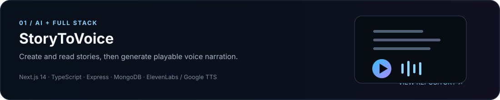
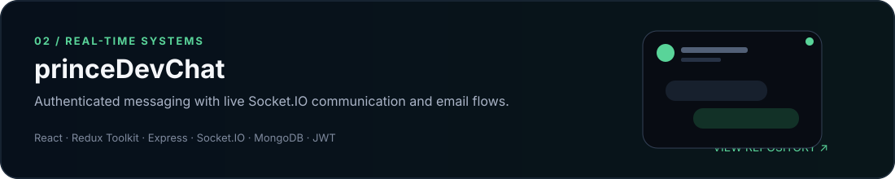
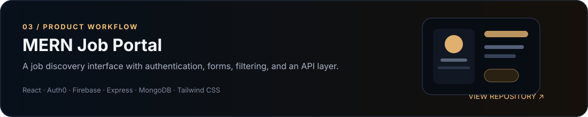
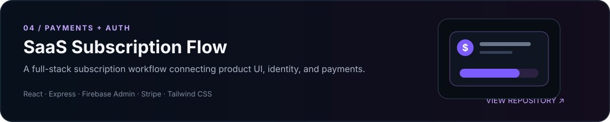
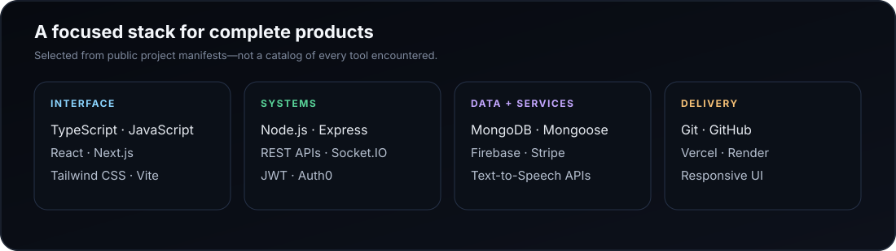

<div align="center">
  
</div>

<p align="center">
  <a href="https://prince-portfolio-hmwm.vercel.app/"><b>Portfolio</b></a>
  &nbsp;·&nbsp;
  <a href="https://www.linkedin.com/in/prince2024/"><b>LinkedIn</b></a>
  &nbsp;·&nbsp;
  <a href="mailto:princekumarbug12344@gmail.com"><b>Email</b></a>
  &nbsp;·&nbsp;
  <a href="https://x.com/Prince_NITrr24"><b>X</b></a>
</p>

## Product-minded engineering, end to end

I’m **Prince Kumar**, a software engineer and NIT Raipur ’24 graduate. I build web products across the interface, API, and data layers—usually with **React or Next.js**, **Node.js**, **Express**, and **MongoDB**.

My public work spans AI-assisted storytelling, real-time communication, authentication flows, and transactional applications. I care about interfaces that feel considered, backends with clear boundaries, and turning an idea into something people can actually use.

```text
$ whoami
> Prince Kumar — full-stack software engineer

$ current_focus
> real-time products · AI-assisted experiences · reliable web systems

$ engineering_mode
> understand the problem → design the boundary → ship the smallest complete system
```

## Selected work

<a href="https://github.com/PrinceNitrr24/StoryToVoice">
  
</a>
<p align="right"><a href="https://story-to-voice-pi.vercel.app">Live demo</a> · <a href="https://github.com/PrinceNitrr24/StoryToVoice">Source</a></p>

<a href="https://github.com/PrinceNitrr24/princeDevChat">
  
</a>
<p align="right"><a href="https://prince-dev-chat.vercel.app">Live demo</a> · <a href="https://github.com/PrinceNitrr24/princeDevChat">Source</a></p>

<a href="https://github.com/PrinceNitrr24/Mern-job-portal">
  
</a>
<p align="right"><a href="https://mern-job-portal-two.vercel.app">Live demo</a> · <a href="https://github.com/PrinceNitrr24/Mern-job-portal">Source</a></p>

<a href="https://github.com/PrinceNitrr24/SAAS">
  
</a>
<p align="right"><a href="https://github.com/PrinceNitrr24/SAAS">Source</a></p>

## Technical toolkit

<div align="center">
  
</div>

<sub>Technologies above are drawn from the selected public repositories and the profile’s documented stack.</sub>

## GitHub signal

<div align="center">
  <picture>
    <source media="(prefers-color-scheme: dark)" srcset="https://github-readme-stats.vercel.app/api?username=PrinceNitrr24&amp;show_icons=true&amp;hide_border=true&amp;bg_color=00000000&amp;title_color=8BD5FF&amp;text_color=C9D1D9&amp;icon_color=A78BFA" />
    <source media="(prefers-color-scheme: light)" srcset="https://github-readme-stats.vercel.app/api?username=PrinceNitrr24&amp;show_icons=true&amp;hide_border=true&amp;bg_color=00000000&amp;title_color=0969DA&amp;text_color=24292F&amp;icon_color=8250DF" />
    
  </picture>
  <picture>
    <source media="(prefers-color-scheme: dark)" srcset="https://github-readme-stats.vercel.app/api/top-langs/?username=PrinceNitrr24&amp;layout=compact&amp;hide_border=true&amp;bg_color=00000000&amp;title_color=8BD5FF&amp;text_color=C9D1D9" />
    <source media="(prefers-color-scheme: light)" srcset="https://github-readme-stats.vercel.app/api/top-langs/?username=PrinceNitrr24&amp;layout=compact&amp;hide_border=true&amp;bg_color=00000000&amp;title_color=0969DA&amp;text_color=24292F" />
    
  </picture>
</div>

<p align="center"><sub>Live cards are generated from public GitHub data; the contribution graph below is GitHub’s native record.</sub></p>

## Let’s build something useful

I’m interested in thoughtful product engineering, ambitious web applications, and teams that value both execution and craft. If that sounds like your kind of work, [send me a note](mailto:princekumarbug12344@gmail.com) or connect on [LinkedIn](https://www.linkedin.com/in/prince2024/).

<div align="center">
  
</div>
