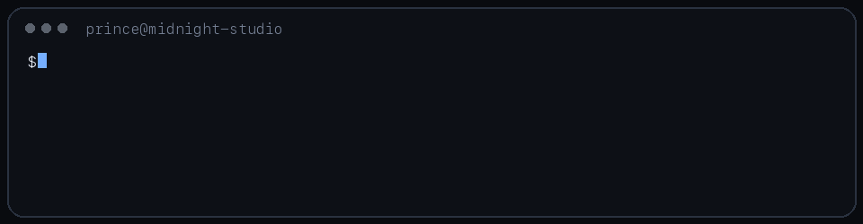
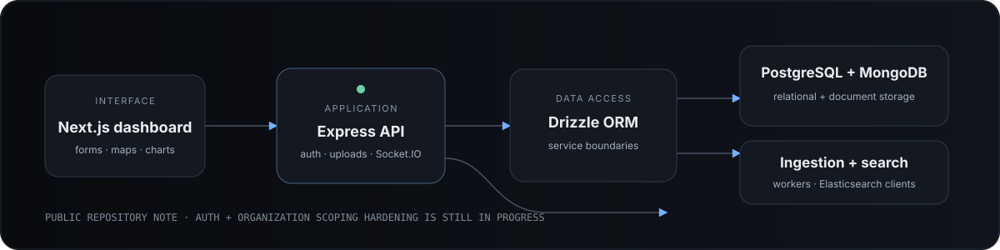
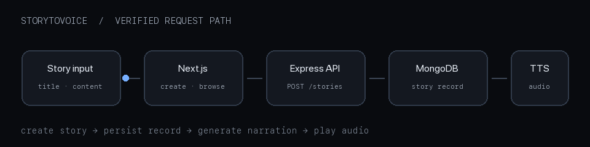
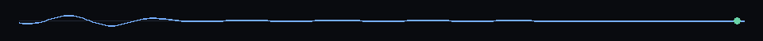

PRINCE KUMAR&nbsp;&nbsp;—&nbsp;&nbsp;SOFTWARE ENGINEER&nbsp;&nbsp;—&nbsp;&nbsp;NEW DELHI

<h1 align="center">Interfaces with restraint. Systems with a pulse.</h1>

  I build full-stack products where the interface, service boundary, and data path 
  have to work as one—from live messaging to generated narration.

  <a href="https://prince-portfolio-hmwm.vercel.app/">Portfolio</a>
  &nbsp;&nbsp;/&nbsp;&nbsp;
  <a href="https://www.linkedin.com/in/prince2024/">LinkedIn</a>
  &nbsp;&nbsp;/&nbsp;&nbsp;
  <a href="mailto:princekumarbug12344@gmail.com">Email</a>
  &nbsp;&nbsp;/&nbsp;&nbsp;
  <a href="https://x.com/Prince_NITrr24">X</a>

  

MIDNIGHT STUDIO&nbsp;&nbsp;·&nbsp;&nbsp;OPEN THE FRAME FOR THE FULL STILL

 

I’m a software engineer and NIT Raipur ’24 graduate. My public work is strongest around **React and Next.js interfaces**, **Node.js services**, **real-time events**, and applications that connect several moving parts without losing clarity.

The part I enjoy most is the handoff between a user action and the system reaction: a message arriving without refresh, a story becoming audio, or an authenticated workflow reaching the right data.

  

---

## Selected systems

### Candidate.live

**A multi-service candidate platform with a Next.js dashboard and an Express backend.** The repository brings together Socket.IO events, uploads, mapping and chart interfaces, MongoDB, PostgreSQL through Drizzle, and ingestion/search services. Its own production-hardening notes are explicit: authentication replacement and complete organization scoping are still in progress.

  

`Next.js 14` &nbsp; `React` &nbsp; `Express` &nbsp; `Socket.IO` &nbsp; `Drizzle` &nbsp; `PostgreSQL` &nbsp; `MongoDB`

[Repository](https://github.com/PrinceNitrr24/candidate_live_next)

 

### StoryToVoice

**A reading experience that turns submitted stories into playable narration.** The Next.js client handles story creation, browsing, sharing, and audio playback. An Express service persists stories in MongoDB and connects the content path to text-to-speech tooling.

  

`Next.js 14` &nbsp; `TypeScript` &nbsp; `Express` &nbsp; `MongoDB` &nbsp; `ElevenLabs`

[Repository](https://github.com/PrinceNitrr24/StoryToVoice)

 

### princeDevChat

**An authenticated, event-driven messaging application.** The React client uses Redux Toolkit for application state while Socket.IO carries live messages through the Express service. MongoDB stores application data; JWT and email tooling support account flows.

  

`React` &nbsp; `Redux Toolkit` &nbsp; `Socket.IO` &nbsp; `Express` &nbsp; `MongoDB` &nbsp; `JWT`

[Repository](https://github.com/PrinceNitrr24/princeDevChat) · [Live demo](https://prince-dev-chat.vercel.app)

---

## Project index

| Focus | Project | Engineering signal |
|:--|:--|:--|
| **Product workflow** | [MERN Job Portal](https://github.com/PrinceNitrr24/Mern-job-portal) | Job discovery and form workflows with React, Auth0, Firebase, Express, and MongoDB. |
| **Commerce** | [SaaS Subscription Flow](https://github.com/PrinceNitrr24/SAAS) | React and Vite client, Express service, Firebase Admin, and Stripe billing. |
| **Backend** | [File App](https://github.com/PrinceNitrr24/File_App) | A compact Express/EJS application for creating, reading, renaming, and deleting filesystem-backed notes. |
| **API study** | [Django Quiz API](https://github.com/PrinceNitrr24/Django-app) | Django REST Framework models and endpoints for categories, quizzes, questions, answers, and random-question retrieval. |
| **Tooling study** | [Vulnerability Scanner](https://github.com/PrinceNitrr24/Vulnerability-Scanner-) | A focused Python/Nmap experiment reporting open ports, state, protocol, and detected services. |

Eight projects are surfaced here: three system features and five concise index entries. Smaller experiments remain discoverable from the repositories tab without crowding this page.

---

## Working set

<table>
  <tr>
    <td width="25%">LANGUAGES  <b>TypeScript</b> <b>JavaScript</b> Python HTML · CSS</td>
    <td width="25%">INTERFACES  <b>React</b> <b>Next.js</b> Redux Toolkit Tailwind CSS</td>
    <td width="25%">SYSTEMS  <b>Node.js</b> <b>Express</b> Socket.IO Django REST</td>
    <td width="25%">DATA + SERVICES  <b>MongoDB</b> PostgreSQL · Drizzle Firebase · Stripe TTS · search clients</td>
  </tr>
</table>

Everything above is visible in public source or project documentation—not a catalog of tools encountered in passing.

---

## Current focus

The clearest next step in the public work is **hardening multi-service product boundaries**: replacing development authentication, completing organization-scoped controllers, keeping frontend and backend contracts explicit, and making test and type checks part of the normal workflow.

[Browse repositories](https://github.com/PrinceNitrr24?tab=repositories) · [View public activity](https://github.com/PrinceNitrr24?tab=overview)

 

  
   
  

